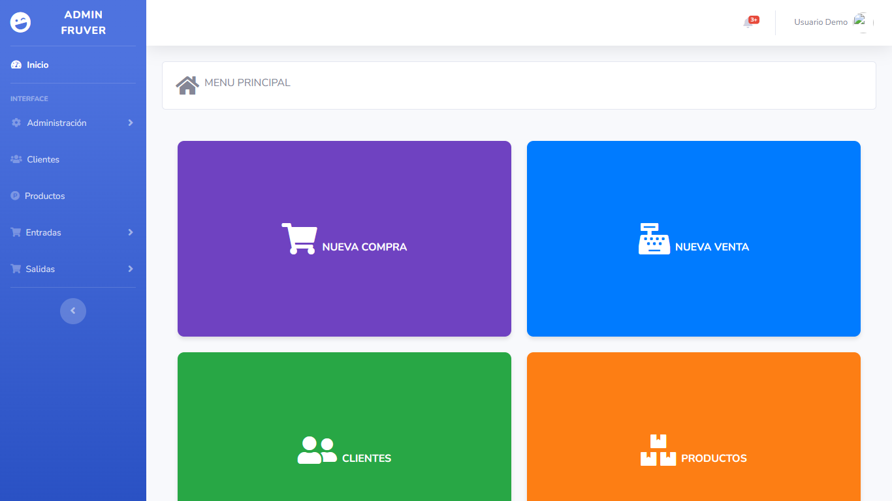
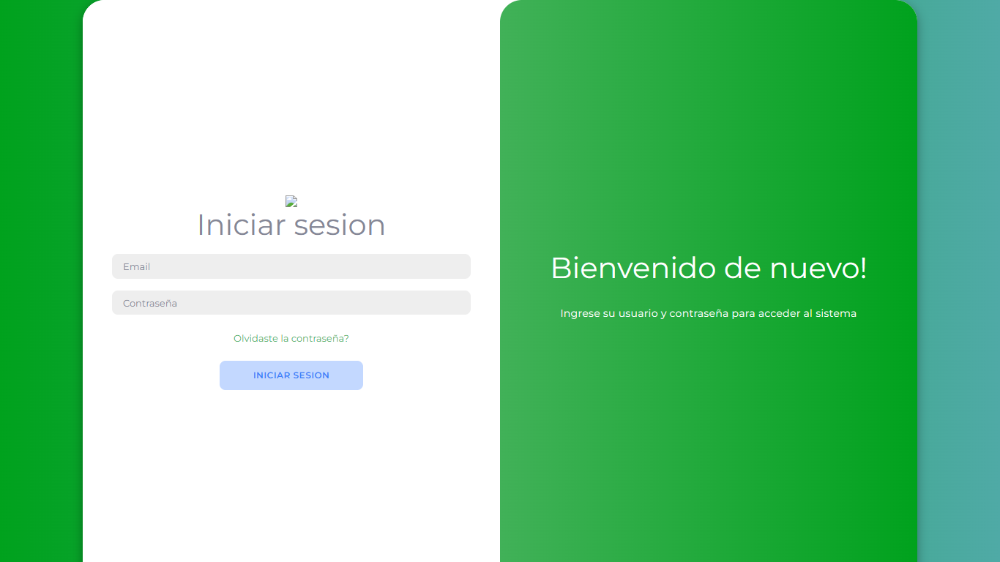
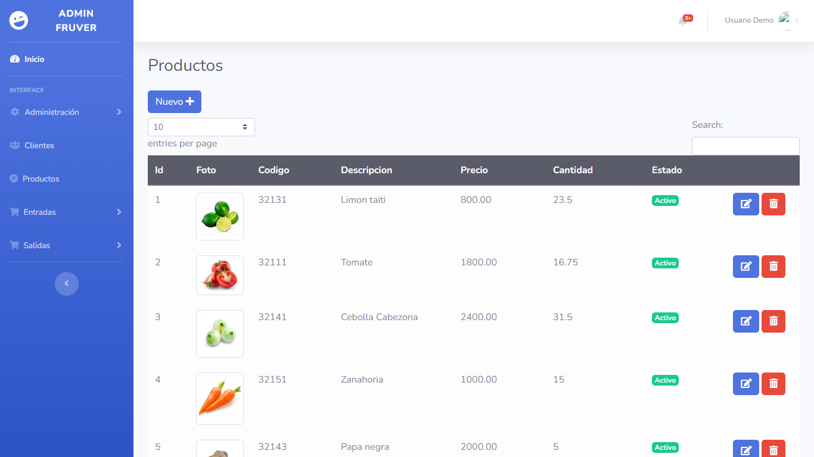
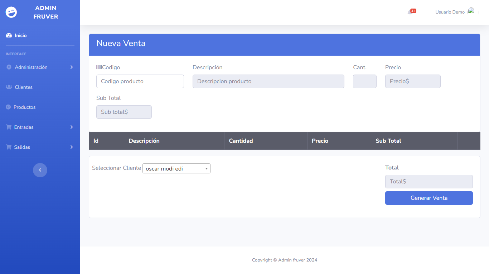
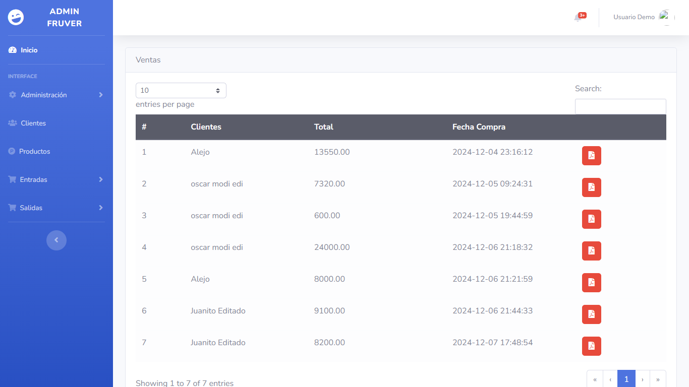

# Admin Fruver: sistema de inventario, compras y ventas

Aplicación web para administrar un Fruver (frutas y verduras). Lleva el inventario, registra las compras a proveedores y las ventas a clientes, y genera la factura en PDF de cada movimiento.

Proyecto formativo de la Tecnología en Análisis y Desarrollo de Software del **SENA** (2024).



## Funcionalidades

- **Inicio de sesión** con contraseñas guardadas con `password_hash()` y cambio de contraseña.
- **Productos** con foto, código, categoría, unidad de medida, precio de compra y de venta, y existencias.
- **Clientes**, **usuarios** y **cajas**, con activación y desactivación de registros.
- **Compras (entradas):** cada compra suma al inventario. Los productos se buscan por código.
- **Ventas (salidas):** cada venta descuenta del inventario y se asocia a un cliente.
- **Facturas en PDF** de compras y ventas, con su historial.
- **Datos de la empresa** que aparecen en las facturas.

## Capturas

| Inicio de sesión | Productos |
|---|---|
|  |  |
| **Nueva venta** | **Historial de ventas** |
|  |  |

## Tecnologías

| Capa | Tecnología |
|---|---|
| Backend | PHP 8 con una arquitectura MVC propia (enrutador, controladores, modelos y vistas) |
| Base de datos | MySQL / MariaDB con PDO y consultas preparadas |
| Interfaz | HTML, CSS, JavaScript, Bootstrap (SB Admin 2), DataTables, Select2 y SweetAlert2 |
| Reportes | FPDF |

## Estructura

```
App_proyecto/
├── index.php            # Enrutador: /Controlador/metodo/parametros
├── .htaccess            # Reescritura de URLs hacia index.php
├── Config/
│   ├── Config.php       # Valores por defecto (XAMPP)
│   ├── Config.local.example.php
│   └── App/             # Conexión PDO, clase Query, Controller y Views base
├── Controllers/         # Usuarios, Clientes, Productos, Compras, Administracion…
├── Models/              # Acceso a datos de cada módulo
├── Views/               # Vistas por módulo y plantillas
├── Assets/              # CSS, JS, imágenes y librerías del cliente
├── Libraries/fpdf/      # Generación de PDF
└── docs/
    ├── sistema.sql      # Esquema de la base de datos (sin datos)
    └── capturas/
```

## Instalación local (XAMPP)

1. Copia la carpeta en `C:\xampp\htdocs\App_proyecto` y arranca **Apache** y **MySQL** desde el panel de XAMPP.
2. Crea la base de datos `sistema` e importa el esquema `docs/sistema.sql` (con phpMyAdmin o con `mysql -u root sistema < docs/sistema.sql`).
3. Crea una caja y el primer usuario. Genera el hash de la contraseña con PHP:
   ```bash
   php -r "echo password_hash('TuClaveSegura', PASSWORD_DEFAULT);"
   ```
   y luego, en MySQL:
   ```sql
   INSERT INTO caja (caja) VALUES ('Caja principal');
   INSERT INTO usuarios (usuario, nombre, clave, id_caja) VALUES ('admin', 'Administrador', '<hash generado>', 1);
   ```
4. Abre <http://localhost/App_proyecto/> e inicia sesión.

### Configuración

`Config/Config.php` trae los valores de XAMPP por defecto (usuario `root` sin contraseña). Para otro entorno, copia `Config/Config.local.example.php` como `Config/Config.local.php` y cambia allí la URL base y las credenciales de la base de datos. Ese archivo está en `.gitignore`, así que nunca se sube al repositorio.

## Seguridad

- Las contraseñas se guardan con `password_hash()` (bcrypt) y se comprueban con `password_verify()`. Las cuentas creadas con la versión anterior, que usaba SHA-256, se migran solas a bcrypt la siguiente vez que inician sesión.
- Las consultas que reciben texto del usuario usan parámetros de PDO para evitar la inyección SQL.
- Al iniciar sesión se regenera el identificador de la sesión.

## Autor

**Angel David Infante Espinel** · [GitHub](https://github.com/Angel-23-I) · [LinkedIn](https://www.linkedin.com/in/angel-david-infante-espinel-a72594266)
